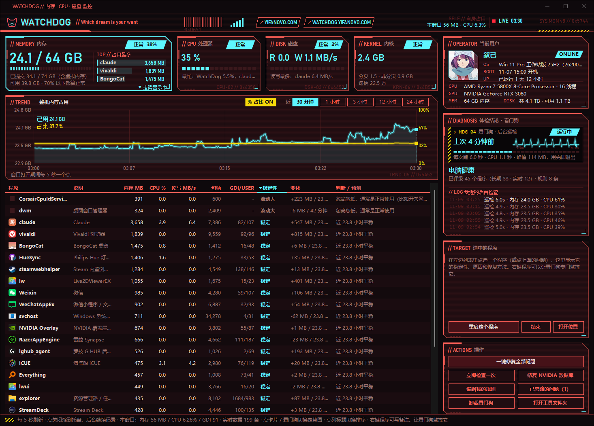
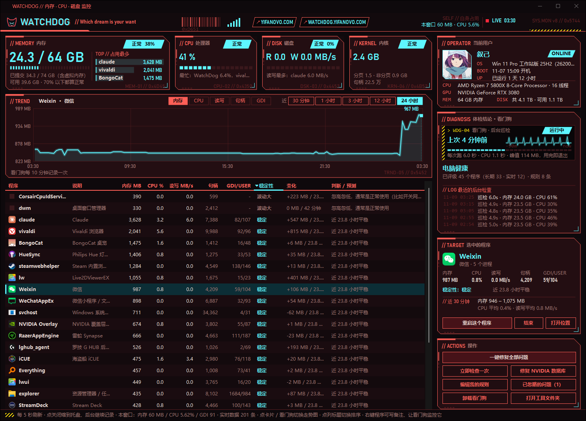

# watchDog

Windows 内存泄漏"体检 + 修复"工具：程序内存泄漏、驱动（内核内存）泄漏、句柄和图形资源（GDI / USER）泄漏都能发现。

任务管理器只能告诉你**现在谁占得多**；watchDog 回答的是：**谁在变坏、为什么、怎么修**。

不需要安装任何依赖：监控窗口 `WatchDog.exe` 是 C# 写的，用 Windows 自带的 .NET Framework 4 编译器生成，独立运行；后台看门狗和修复脚本是 PowerShell 脚本（Windows 10 / 11 自带），每次只运行几秒。



## 和任务管理器有什么区别

| | 任务管理器 | watchDog |
|---|---|---|
| 看到的 | 此时此刻的占用 | 近 30 分钟 / 1 / 3 / 12 / 24 小时的走势：内存、CPU、磁盘、每个程序 |
| 看不到的 | 驱动占的内存、句柄和 GDI 一直涨 | 内核内存池（驱动用的内存）走势，能指出是哪个标签 / 哪个驱动在涨；每个程序的句柄数、GDI / USER 对象数和走势 |
| 能告诉你 | 谁占得多 | 每个程序是 **稳定 / 波动大 / 缓慢上涨 / 疑似泄漏**，并预测"照这个速度会涨到多少"。窗口打开 10 分钟就有初步判断 |
| 遇到问题 | 只能"结束任务" | 命中**问题规则库**时给出原因说明和对应的修复方法（重启程序 / 重启服务 / 重建文件） |
| 你不在电脑前 | 什么也不做 | 看门狗每 10 分钟自动检查，按规则自动修复 |
| 自身负担 | 打开就卡 | 后台检查每 10 分钟跑约 5 秒就退出；窗口只在打开时运行 |

## 包含什么

| 文件 | 作用 |
|---|---|
| `Build-Exe.ps1` | 把 `src/` 里的 C# 代码编译成 `WatchDog.exe`，并生成图标（exe 不进 git，自己生成） |
| `WatchDog.exe`（源码在 `src/`） | **监控窗口**（赛博朋克风格：红黑底 + 荧光蓝）。顶部内存（大卡片，含占用最多的程序）/ CPU / 磁盘 / 内核卡片；右侧"体检结论"上方是看门狗的状态和"心跳"（最近每次后台检查），下面直接告诉你电脑是否健康、有哪些问题；程序列表默认把有问题的排在最前；选中程序可看 24 小时曲线、原因和修复按钮 |
| `MemWatchdog.ps1` | **看门狗**：按规则检查，`auto: true` 的规则命中时自动修复；同时记录历史数据给监控窗口用 |
| `rules.json` | **公共问题规则库**：已知问题的"症状 → 原因 → 修复方法" |
| `rules.local.json` | **你自己的规则**（不进 git）。第一次在窗口里点"编辑我的规则"时会从 `rules.local.example.json` 复制一份 |
| `Install-Watchdog.ps1` | 把看门狗安装为计划任务（每 10 分钟 + 登录时运行）。加 `-Uninstall` 卸载。也可以在窗口里一键安装 |
| `Fix-NvTopps.ps1` | 重建膨胀的 NVIDIA `nvtopps.db3` 数据库（只保留一份备份 `nvtopps.bak`） |
| `Restart-ServiceHard.ps1` | 安全地重启服务：卡在"正在停止"时强制结束，但只在该服务独占进程时才这么做，不会误伤同一进程里的其他系统服务 |
| `extras/SonicStudio*` | （可选，仅华硕 Sonic Studio 用户）一键开关 Sonic Studio |

## 使用

1. 第一次使用：右键 `Build-Exe.ps1` → 用 PowerShell 运行，生成 `WatchDog.exe`（用 Windows 自带的 C# 编译器，不下载任何东西）。以后双击 `WatchDog.exe` 打开监控窗口；也可以右键它"发送到桌面快捷方式"或固定到任务栏。`WatchDog.exe` 要和其他脚本放在同一个文件夹里（它读这里的规则和记录，修复时也调用这里的脚本）。更新代码后重新运行一次 `Build-Exe.ps1`：如果 WatchDog 正在运行，它会先让 WatchDog 存好数据退出（`WatchDog.exe --exit`），编译完再重新打开。
2. 在右侧"操作"里点"安装看门狗"，确认管理员权限。
3. 窗口打开 10 分钟后给出初步稳定性判断；看门狗记录满 1 小时后给出长期判断（包括"疑似泄漏"）。
4. 走势图默认显示**整机内存、近 30 分钟**。点顶部的 **内存 / CPU / 磁盘 / 内核** 卡片、或右侧的看门狗面板切换内容；点列表里的程序，看这个程序的走势。右上角可选近 **30 分钟 / 1 小时 / 3 小时 / 12 小时 / 24 小时**：1 小时以内用窗口的实时数据（5 秒一个点），3 小时以上用看门狗的记录（10 分钟一个点）。
5. **发现的问题可以"忽略"或"确认正常"**：体检结论里每个问题右边有两个小按钮，右键程序也可以。"忽略"是 24 小时内不提醒；"确认正常"是以后不再提醒，规则发现的问题看门狗也不会再自动处理。记录在 `ignore.json`（个人设置，不进 git），"操作"里的"已忽略的问题"可以一键恢复。
6. 标题栏中间显示**自身占用**：看门狗每次后台运行多久、用了多少 CPU 时间、峰值内存，以及本窗口的内存 / CPU。
7. **托盘图标一直都在**；点关闭或最小化只是把窗口藏到托盘，在后台继续每 5 秒记录（打开和藏起来时记录的数据完全一样，只是藏起来时不画界面）。点托盘图标重新打开；**要退出：右键托盘图标 → 退出**。只会开一个：已经在运行时再双击 `WatchDog.exe`，会把原来的窗口叫出来。任务栏显示 WatchDog 自己的图标，可以固定到任务栏。
8. **关掉再打开，之前的记录还在**：实时数据每 5 分钟和关闭时存到 `data/live.bin`（不进 git），打开时读回最近 1 小时的；更早的走势用看门狗的记录。中断不超过 30 分钟的程序，稳定性判断会接着之前的数据算。
9. **右键程序 → 用看门狗监控**：设一个内存上限，超过时提醒你或自动重启它。看门狗会专门记录它的走势。列表里带 ◉ 的就是被监控的程序。
10. **选中程序后，走势图右上角可以切换"内存 / CPU / 读写 / 句柄 / GDI"**。CPU、读写、GDI / USER 只有窗口的实时数据（30 分钟 / 1 小时）；看门狗的记录里每个程序有内存和句柄数。
11. **右键程序 → 写备注说明**：给程序写一句自己的说明，会替换"说明"列里的默认说明。存在 `notes.json`（个人设置，不进 git）；清空备注就恢复默认说明。
12. **右上角"当前用户"**：点头像上传一张图片，点名称修改显示的名字（不是登录，只是展示）。下面显示电脑的系统版本、开机时间、已运行多久、CPU、显卡、内存和磁盘大小。头像和名字存在 `avatar.png`、`profile.json`（不进 git）。
13. **内核卡片**：显示驱动用的内存（分页池 + 非分页池）和全系统句柄总数，点它看走势（右上角切换"内存池 / 句柄"）。走势图下面列出占用最多、窗口打开后涨得最多的内存池标签。程序列表多了"句柄"和"GDI/USER"两列，可以点列标题排序。详见下面的"驱动泄漏、句柄和图形资源泄漏"。

## 截图

选中一个程序，看它的走势、稳定性评级和预测：



## 看门狗在做什么

每 10 分钟在后台运行约 5 秒，然后退出，不常驻内存：

1. **按规则检查**：`rules.json` + `rules.local.json` 里 `auto: true` 的规则命中时自动修复（比如重启泄漏的托盘程序、重建 NVIDIA 数据库），其余只记录提醒。
2. **记录历史**：记下内存占用前 30 的程序、句柄最多的 10 个程序、规则 / 监控涉及的程序（每个程序记内存和句柄数），以及整机内存 / CPU / 磁盘 / 内核内存池 / 句柄总数，用来画 24 小时走势、判断长期稳定性。

## 稳定性评级

只看最近一次重启之后的数据（内存骤降 40% 以上或断档视为重启）。

**长期判断**（看门狗记录 ≥ 1 小时，10 分钟一个点）：

| 评级 | 条件 | 含义 |
|---|---|---|
| 疑似泄漏 | 每小时涨 ≥ 50 MB，累计 ≥ 100 MB，涨势稳定（R² ≥ 0.6） | 建议重启它 |
| 缓慢上涨 | 每小时涨 ≥ 15 MB，累计 ≥ 40 MB，R² ≥ 0.5 | 先观察 |
| 波动大 | 波动幅度超过平均值的 15% | 通常是正常使用（比如浏览器开关网页） |
| 稳定 | 以上都不是 | 占用再大也不算问题 |

**短期判断**（窗口打开期间的实时数据 ≥ 10 分钟，5 秒一个点）：只给"短时上涨 / 波动大 / 稳定（初步）"，**不下"泄漏"结论**——程序在 10 分钟里涨一点往往是正常的（比如浏览器加载网页），满 1 小时才判断是否泄漏。

## 驱动泄漏、句柄和图形资源泄漏

程序列表看不到的两类"越用越卡"：

**驱动（内核内存）泄漏**：驱动申请的内存在内核的"分页池 / 非分页池"里，任务管理器的进程列表看不到，表现是总内存一直涨、但各程序加起来对不上。每个驱动申请内存时都带一个 4 个字母的"标签"，WatchDog 每 10 分钟拍一次按标签分开的明细（不需要管理员权限），所以能看出是哪个标签在涨；不认识的标签会在后台到驱动文件里搜一次，告诉你可能是哪个驱动（比如 `NVRM` → `nvlddmkm.sys · NVIDIA`）。

| 判断 | 条件 |
|---|---|
| 疑似泄漏（长期，本次开机以来看门狗记录 ≥ 3 小时） | 非分页池每小时涨 ≥ 15 MB、累计 ≥ 150 MB；或分页池每小时涨 ≥ 40 MB、累计 ≥ 400 MB；涨势稳定（R² ≥ 0.75） |
| 缓慢上涨（长期） | 非分页池每小时 ≥ 6 MB、累计 ≥ 80 MB；或分页池每小时 ≥ 15 MB、累计 ≥ 200 MB（R² ≥ 0.6） |
| 上涨中（实时，≥ 30 分钟） | 非分页池涨 ≥ 150 MB 或分页池涨 ≥ 300 MB，涨势很稳（R² ≥ 0.85）。只提醒观察 |
| 偏高 / 过高 | 非分页池 ≥ 2 / 4 GB，或分页池 ≥ 4 / 8 GB |

处理：更新或回退最近装 / 更新过的驱动（显卡、网卡、杀毒、灯效、外设），重启电脑可以立即收回。

**句柄和图形资源泄漏**：每个程序都记录句柄数和 GDI / USER 对象数。GDI、USER 单个进程上限 1 万个，用完了窗口、菜单就画不出来。

| 判断 | 条件 |
|---|---|
| 图形资源快用完 | 单个进程 GDI 或 USER ≥ 5000（黄）/ ≥ 8000（红） |
| 图形资源在一直涨（实时，≥ 20 分钟） | GDI 或 USER 涨 ≥ 500 个、每小时 ≥ 500 个、R² ≥ 0.85；已经 ≥ 3000 时算红色 |
| 疑似句柄泄漏（长期，看门狗记录 ≥ 2 小时） | 每小时涨 ≥ 500 个、累计 ≥ 3000 个、R² ≥ 0.7（缓慢上涨：≥ 200 个/小时、累计 ≥ 1500） |
| 句柄在一直涨（实时，≥ 20 分钟） | 涨 ≥ 3000 个、每小时 ≥ 3000 个、R² ≥ 0.85 |
| 句柄数异常多 | 单个进程 ≥ 5 万（黄）/ ≥ 10 万（红） |

这类问题重启那个程序就能释放；"一键修复"会重启红色的那些（系统关键进程除外，比如 `System` 的句柄一直涨通常是驱动引起的，只能重启电脑）。也可以"忽略"或"确认正常"。

## 问题规则库

每条规则写明症状、原因和修复方法，例如：

```json
{
  "id": "lghub-tray",
  "title": "罗技 G HUB 托盘泄漏",
  "target": "lghub_system_tray",
  "when": { "process": "lghub_system_tray", "minMB": 800 },
  "cause": "G HUB 托盘程序的已知问题……重启它不影响鼠标键盘的设置和灯效。",
  "fix": { "type": "restartProcess", "label": "重启 G HUB 托盘" },
  "auto": true
}
```

- `when`：`process`（进程名；`svc:服务名` 表示承载该服务的进程）+ `minMB`，和/或 `file` + `minFileMB`。条件全部满足才算命中。
- `fix.type`：`restartProcess` 重启程序 / `restartService` 重启服务 / `script` 运行本目录下的脚本 / `none` 只提醒。
- `auto: true`：看门狗会自动执行修复；`false` 只在窗口里提醒。
- 没有命中任何规则、但被评为"疑似泄漏"的程序，可以在窗口里直接重启（通用修复）。

目前内置的规则：NVIDIA 数据库膨胀、NVIDIA 显示容器占用过高、Windows 音频服务泄漏、罗技 G HUB 托盘泄漏、华硕 Aura 灯效服务占用过高。欢迎提交新的规则。

## 自身占用（作者电脑实测，16 核）

| 部分 | 什么时候运行 | CPU | 内存 |
|---|---|---|---|
| 后台检查 `MemWatchdog.ps1` | 每 10 分钟一次，约 5 秒 | 每次约 1 秒 CPU 时间，平均约占整机 0.01% | 运行时峰值约 100 MB，结束后全部释放 |
| 监控窗口 `WatchDog.exe` | 打开或在托盘里时 | 约 0.1% | 约 50–58 MB，退出即释放 |

## 自身不会泄漏

- 看门狗每次运行几秒，检查完就退出，不常驻内存。
- 读取进程读写量、GDI / USER 数、程序路径时，系统句柄打开后立即关闭（读写量和 GDI 共用一次打开）；磁盘计数器只打开一次，关窗时关闭；程序图标缓存最多 150 个。
- 实时数据存在固定大小的环形缓存里：每条最多 720 个点（1 小时），最多 320 条，满了覆盖最旧的；15 分钟没出现的程序会被清掉。句柄 / GDI 只记最多的 15 个程序（加上有问题的和选中的）。
- 内存池明细只存排好序的数组（每张约 40 KB），最多 8 张（窗口打开时一张 + 最近 1 小时每 10 分钟一张）；搜驱动在后台线程里做，每个标签只搜一次，用 1 MB 缓冲区分段读，不把驱动文件整个读进内存。
- 列表原地更新（只改变化了的格子），不清空重建，也不先擦背景再画，所以不会闪，滚动位置也不会跳。
- 监控窗口在打开或缩到托盘时运行（托盘里只记录、不画界面），所有临时数据每次刷新整体替换；底部实时显示窗口自身占用。
- 实时数据存盘文件大小有上限（最多 320 条 × 720 个点，约 2.8 MB），先写临时文件再替换，写一半断电也不会坏。
- 所有画笔 / 画刷 / 字体只在启动时创建一次，绘制时复用，避免 GDI 资源泄漏。
- 自测：`WatchDog.exe --selftest --loops 1800 --sim 60` 在屏幕外连续刷新并完整重绘 1800 次（约等于开着窗口 2.5 小时），每 150 次记录一次，结果写到 `selftest.txt`：实时数据缓存一开始就填满 1 小时；自身内存一直在 57–58 MB、不往上涨，托管堆始终 3.7 MB，GDI 对象始终 91，句柄数在 510–518 之间、不增加。另外用每秒约 80 帧的连续截屏检查过刷新时列表不闪。
- 历史数据每天约 260 KB，只保留 7 天。

## 已知的泄漏来源（作者电脑上实测）

- **NVIDIA NVDisplay.Container**：`nvtopps.db3` 膨胀到 2 GB+，导致容器占用 8 GB 内存并持续读写硬盘。重建数据库后降到约 24 MB。
- **Windows 音频服务（Audiosrv）**：装有 Sonic Studio / Nahimic 时长时间运行可涨到 2 GB+。
- **罗技 G HUB 托盘程序**（`lghub_system_tray`）：长时间运行可涨到数 GB。只重启托盘，不影响设备设置。
